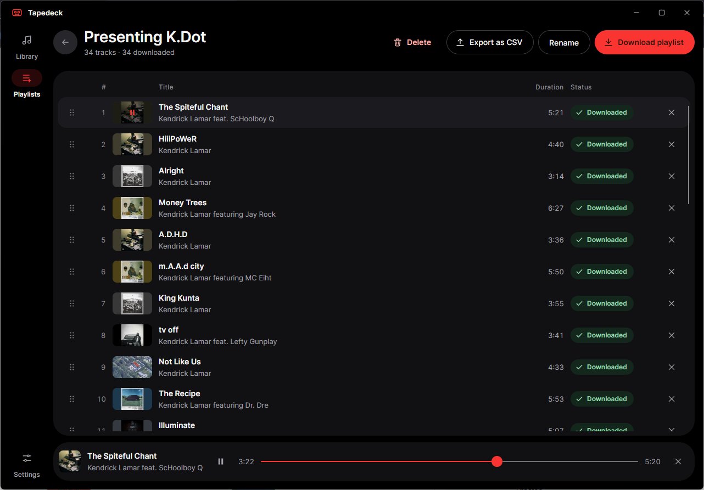
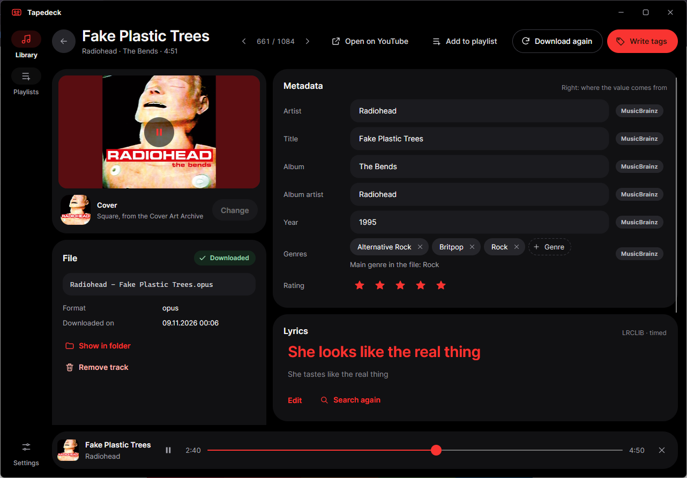

<div align="center">


# Tapedeck

**Your YouTube links, turned into a real music library.**

Paste a link, get a clean, tagged Opus file and a library your phone actually understands.

[](https://github.com/0xnkr/Tapedeck/actions/workflows/ci.yml)
[](https://dot.net)
[](https://avaloniaui.net)
[](https://github.com/yt-dlp/yt-dlp)
[](#build-it-yourself)
[](LICENSE)

<br />



</div>

---

## Why Tapedeck?

Most of the music you love is on YouTube, but a list of browser tabs isn't a library. Tapedeck treats **your list of links as the source of truth** and makes sure every track also exists as a local file with proper tags. Copy the folder to your phone and Poweramp, Musicolet & co. show artists, albums, genres and covers right away.

- **Links first.** Your library is a list of YouTube links. Files can always be downloaded again.
- **No quality loss.** YouTube already serves Opus, so Tapedeck stores it as is without re-encoding.
- **Clean tags.** Your corrections win over [MusicBrainz](https://musicbrainz.org), which wins over YouTube's metadata and the parsed video title. You always see where a value comes from.
- **Made for Android.** Flat folder with `Artist - Title.opus` names that work on FAT32 and exFAT, plus `.m3u8` playlists that players pick up on their own.

## Features

| | |
|---|---|
| 🔗 **Add anything** | Paste a video or playlist link: `watch?v=`, `youtu.be`, Shorts, YouTube Music. Metadata comes in via `yt-dlp -J`. |
| ⬇️ **Download as Opus** | Several tracks at once (3 by default, 2 on the phone), live progress, cancel at any time, and missing files are detected and fetched again. |
| 🧠 **MusicBrainz matching** | New tracks are looked up on MusicBrainz in the background: proper album, album artist, release year, track number, genres and a square cover from the Cover Art Archive (or, without one, cut from the middle of the video thumbnail). Music videos get the album they belong to, and uncertain matches wait for you to confirm them. |
| ✏️ **Fix the metadata** | Correct artist, title, album, album artist and year. Changes save while you type, and source chips show where each value comes from. |
| 🎼 **Stable genres** | Fine genres like *G-Funk*, *Deep House* or *Dance-Pop* are mapped to a few main genres such as Hip-Hop, Electronic or Pop, and only those go into the file, so your phone sorts a mixed library into clear groups. Tracks MusicBrainz has no genres for can get them from [Last.fm](https://www.last.fm) with your own free API key. |
| 🏷️ **Write real tags** | Title, artist, album, album artist, year, track number, genres, cover art, lyrics, MusicBrainz IDs and the YouTube link go straight into the file. Files are renamed to match your corrections. |
| 🎤 **Lyrics** | Lyrics come from [LRCLIB](https://lrclib.net) in the background, timed wherever the timing really fits the file. They go into the file and, when timed, also as a `.lrc` next to the song, so phone players show the lines along with the music. In Tapedeck the line sung now follows the song, and a click jumps to any line. Paste or correct your own at any time. |
| 🧹 **No duplicates** | The same song from the music video, the Topic upload and a lyric video? The **Duplicates** filter puts them side by side, and **Keep this one** removes the rest without breaking your playlists. |
| 🔊 **Even volume** | Every download is measured once with FFmpeg (EBU R 128), and the result goes into the file as an Opus track gain (`R128_TRACK_GAIN`). Loud music videos and quiet Topic uploads then play equally loud in Poweramp, Musicolet & co. Older tracks are measured in the background, and the built-in player levels them the same way. |
| 🧭 **Ready for recommendations** | Every song gets its tempo, brightness, energy and dynamics measured, plus the Last.fm tags of its artist and, if you like, your Spotify plays. All of it goes into the file, so a player on the phone can play similar songs that match the mood, not only the genre. The fields and a reference recommender are described in [docs/recommendations.md](docs/recommendations.md). |
| 🎶 **Playlists** | Drag to reorder, add from any track, and every playlist is auto-exported as `.m3u8` next to your music. |
| ▶️ **Listen in** | Click a cover to play the downloaded file, click again to pause. A small player bar shows the progress and lets you jump to any spot, on Windows, Linux and macOS alike. |
| ✨ **Smart playlists** | Playlists that fill themselves from rules, like "genre contains Trap and year 2012 to 2016" or "the 50 newest tracks". They stay up to date as your library changes and land on your phone as normal `.m3u8` playlists. |
| 🎧 **Import from Spotify** | Bring your Spotify favorites along: Tapedeck reads your extended streaming history, counts real plays, finds each song as the plain release on YouTube Music and adds them as a playlist, most played first. A public Spotify playlist works the same way: paste its link, no Spotify account needed (up to its first 100 songs). Unsure matches wait for you to pick the right video, and the search keeps its place across restarts. |
| 🔄 **Linked YouTube playlists** | Import a YouTube playlist once and hit **Sync** later to pull in new videos. Nothing is ever removed or reordered behind your back. |
| 💾 **Backup and move** | Export the library or a single playlist as CSV and import it on another machine. Files already in the folder are recognized, so nothing is downloaded twice. |
| 🧰 **Zero setup** | yt-dlp, FFmpeg and Deno are downloaded on first use, and yt-dlp updates with one click. |

<div align="center">



<sub>Every value shows where it comes from. Here MusicBrainz found the album, year and genres, the Cover Art Archive the square cover, and the timed lyrics from LRCLIB follow the song: the line sung now in large type, the next one below.</sub>

</div>

## Getting started

1. Grab `Tapedeck.exe` from the [releases](https://github.com/0xnkr/Tapedeck/releases) or [build it yourself](#build-it-yourself).
2. Start it. No installer and no .NET runtime needed.
3. Paste a YouTube link into the link bar and press **Add**.
4. Hit **Download pending** and watch the vinyl spin. 💿

Your music lands in `Music/Tapedeck` by default, and you can change that in the settings. App data (database, settings, tools, thumbnails) lives in the system's application data folder, `%APPDATA%\Tapedeck` on Windows.

### On your phone (Android)

Tapedeck also runs on Android phones (Android 13 or newer, 64-bit ARM). It is a standalone app with its own library in `Music/Tapedeck`, which every music player on the phone picks up. Share a link from the YouTube or YouTube Music app to Tapedeck to add it.

1. Download `Tapedeck-<version>.apk` from the [releases](https://github.com/0xnkr/Tapedeck/releases) on the phone and open it. Android asks you once to allow installing apps from your browser or file manager.
2. On first start, Tapedeck asks for **access to all files**. It needs it to write the songs, lyrics and playlists into `Music/Tapedeck` and to rename them when you correct a title. Without it, the app starts, but cannot download.
3. Downloads keep running with the screen off; a notification shows the progress.

The app is not on Google Play: Play does not allow apps that download from YouTube or that ask for access to all files. Updates are installed the same way, over the old version; your library stays. The Spotify import and the command line options are desktop-only. To move between computer and phone, export the library as CSV, copy the music folder and import the CSV on the other side.

> [!TIP]
> Coming from Spotify? In your Spotify account, request the **Extended streaming history** under privacy. Spotify sends a zip file after a few days. Then open **Playlists → From Spotify**, choose the zip and search your most played songs on YouTube. For a single playlist, paste its link there instead.

> [!TIP]
> Moving to a new computer? Export the library as CSV, copy the music folder, then import the CSV on the new machine. Tapedeck finds the existing files and marks them as downloaded.

> [!TIP]
> Something went wrong? **Settings → Tools** shows the exact version and build, and **Open log** opens `log.txt` with every download, import and error. Attach both to a bug report.

## Third-party tools and licenses

> [!IMPORTANT]
> The desktop app does **not** ship these tools. On first use it downloads them from the official release channels into its app data folder (`tools/`). **By downloading and using Tapedeck you agree to the licenses of these tools.**
>
> The Android app cannot download programs, so its APK ships yt-dlp, Python, FFmpeg and [QuickJS-ng](https://github.com/quickjs-ng/quickjs) (instead of Deno). Python and FFmpeg are the Termux builds published by [youtubedl-android](https://github.com/JunkFood02/youtubedl-android), with the libraries they need; all of them are listed with their licenses in [THIRD-PARTY-NOTICES.md](THIRD-PARTY-NOTICES.md#android-app).

| Tool | What it does | License |
|---|---|---|
| [yt-dlp](https://github.com/yt-dlp/yt-dlp) | Reads metadata and downloads the audio from YouTube | [Unlicense](https://github.com/yt-dlp/yt-dlp/blob/master/LICENSE) |
| [FFmpeg](https://ffmpeg.org) | Post-processes the downloaded audio and measures its loudness (prebuilt static build; the Windows build is GPL-licensed) | [LGPL / GPL](https://ffmpeg.org/legal.html), see [GPL v3](https://www.gnu.org/licenses/gpl-3.0.html) |
| [Deno](https://deno.com) | JavaScript runtime that yt-dlp needs for YouTube | [MIT](https://github.com/denoland/deno/blob/main/LICENSE.md) |

You can check the installed versions and update yt-dlp under **Settings → Tools**.

Metadata comes from [MusicBrainz](https://musicbrainz.org) (core data under [CC0](https://musicbrainz.org/doc/About/Data_License)) and covers from the [Cover Art Archive](https://coverartarchive.org). Tapedeck asks them at most once per second, as MusicBrainz requests, and you can turn off the automatic lookup under **Settings → Tools**. Genres for tracks without MusicBrainz genres can come from the tags listeners gave the artist on [Last.fm](https://www.last.fm), with your own API key; Last.fm then gets the artist names. Lyrics come from [LRCLIB](https://lrclib.net), a free lyrics database, which gets artist, title, album and length of your downloaded tracks; that lookup can be turned off under **Settings → Tools** as well.

## Please use it responsibly

Tapedeck is a personal tool for building a library of music you are allowed to keep. Downloading from YouTube may violate [YouTube's Terms of Service](https://www.youtube.com/t/terms) and copyright law where you live. You are responsible for what you download. Support the artists you listen to. 💛

Tapedeck is not affiliated with YouTube, Spotify, MusicBrainz or LRCLIB. Lyrics are stored for your own library only; please don't share them on. It reads only the Spotify data download you request yourself and the public pages of playlists you paste, and does not use the Spotify API.

## Build it yourself

You need the [.NET 10 SDK](https://dotnet.microsoft.com/download/dotnet/10.0). Any IDE works; the project is set up for JetBrains Rider.

```bash
git clone https://github.com/0xnkr/Tapedeck.git
cd Tapedeck
dotnet run --project Tapedeck.Desktop
```

Run the tests:

```bash
dotnet test
```

Build a single self-contained `Tapedeck.exe` (Windows x64, about 50 MB) into `publish/win-x64/`:

```bash
dotnet publish Tapedeck.Desktop -p:PublishProfile=win-x64
```

The executable bundles the .NET runtime and native libraries. Trimming is off on purpose because Dapper and the dependency injection rely on reflection. For Linux or macOS use `dotnet publish Tapedeck.Desktop -c Release -r linux-x64 --self-contained -p:PublishSingleFile=true` (or `osx-arm64`); those builds are not tested yet.

The Android app needs the Android workload and, once, the tools it ships (Python, FFmpeg, QuickJS-ng and yt-dlp, each pinned by version and SHA-256). Then build or install it on a connected phone:

```bash
dotnet workload install android
```

```bash
powershell -ExecutionPolicy Bypass -File tools/android-natives.ps1
```

```bash
dotnet build Tapedeck.Android -t:Install
```

Releases are built by GitHub Actions: every push runs the tests, and a version tag such as `v0.1.0` publishes `Tapedeck.exe` and the signed APK (each with its SHA-256) as a [release](https://github.com/0xnkr/Tapedeck/releases). The release notes are the tag's section of the [changelog](CHANGELOG.md), so rename `## [Unreleased]` to `## [0.1.0] - <date>` before tagging. Every step is in [docs/release.md](docs/release.md).

Handy command line options for a single run:

```bash
dotnet run --project Tapedeck.Desktop -- --lang de --accent "#C8B6FF"
```

Two options work on a Spotify history without opening a window. They write a Markdown report into the history folder: `--spotify-report` the plays, top songs and artists, `--spotify-match` how the first songs (100 by default) are found on YouTube, for tuning the matching:

```bash
dotnet run --project Tapedeck.Desktop -- --spotify-report "path/to/my_spotify_data.zip"
```

```bash
dotnet run --project Tapedeck.Desktop -- --spotify-match "path/to/my_spotify_data.zip" 100
```

`--audio-report` measures the sound of every song that has no value yet and writes `audio-report.md` into the app data folder: how tempo, brightness and energy spread over your library, and for some songs the ones that sound most alike. See [docs/recommendations.md](docs/recommendations.md#checking-and-tuning):

```bash
dotnet run --project Tapedeck.Desktop -- --audio-report 20
```

## Roadmap

- [x] Library, downloads, corrections, tags, ratings
- [x] Playlists with `.m3u8` export and linked YouTube playlists
- [x] CSV backup, restore and moving to another computer
- [x] Better metadata from [MusicBrainz](https://musicbrainz.org) and square covers from the [Cover Art Archive](https://coverartarchive.org)
- [x] Genres from [Last.fm](https://www.last.fm), mapped to stable main genres
- [x] Timed lyrics from [LRCLIB](https://lrclib.net), in the file, as `.lrc` and live in the app
- [ ] Installer and auto updates
- [x] Smart playlists
- [x] Import of the most played songs from the Spotify streaming history
- [x] Import of public Spotify playlists by their link
- [ ] Auto playlists
- [ ] Filtering the library by playlist

See the [changelog](CHANGELOG.md) for what changed.

## License

Tapedeck is released under the [MIT License](LICENSE). Use it, fork it, ship it.

The published `Tapedeck.exe` and the APK bundle a few open source libraries. Their copyright notices and license texts are collected in [THIRD-PARTY-NOTICES.md](THIRD-PARTY-NOTICES.md) and built into the app: click any license under **Settings → Open source** to read it, even offline. The downloaded tools keep their own licenses, see [Third-party tools and licenses](#third-party-tools-and-licenses).

## Credits

Tapedeck stands on the shoulders of these great projects:

- **[yt-dlp](https://github.com/yt-dlp/yt-dlp)** does the heavy lifting with YouTube. ([Unlicense](https://github.com/yt-dlp/yt-dlp/blob/master/LICENSE))
- **[FFmpeg](https://ffmpeg.org)** is the Swiss army knife of audio and video. ([LGPL / GPL](https://ffmpeg.org/legal.html))
- **[YoutubeDLSharp](https://github.com/Bluegrams/YoutubeDLSharp)** is the C# wrapper that drives yt-dlp and installs the tools. ([BSD-3-Clause](https://github.com/Bluegrams/YoutubeDLSharp/blob/master/LICENSE.txt))

Also built with [Avalonia](https://avaloniaui.net) (MIT), [Deno](https://deno.com) (MIT), [TagLibSharp](https://github.com/mono/taglib-sharp) (LGPL-2.1), [Concentus](https://github.com/lostromb/concentus) (BSD-3-Clause), [OpenAL Soft](https://openal-soft.org) (LGPL), [Silk.NET](https://github.com/dotnet/Silk.NET) (MIT), [SQLite](https://sqlite.org) (Public Domain), [Microsoft.Data.Sqlite](https://learn.microsoft.com/dotnet/standard/data/sqlite/) (MIT), [Dapper](https://github.com/DapperLib/Dapper) (Apache-2.0), [CommunityToolkit.Mvvm](https://github.com/CommunityToolkit/dotnet) (MIT), [.NET](https://dot.net) (MIT) and the [Inter](https://rsms.me/inter/) typeface (OFL-1.1). The same list, with every license text, is in the app under **Settings → Open source** and in [THIRD-PARTY-NOTICES.md](THIRD-PARTY-NOTICES.md).